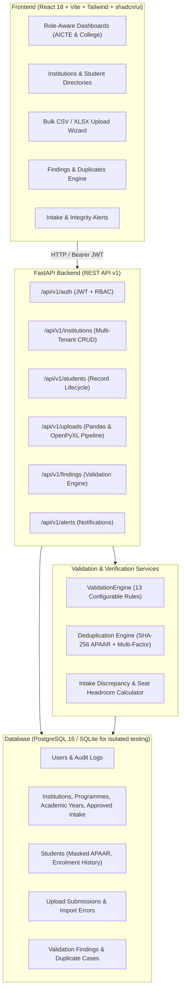

# VidyaVerify — Architecture Overview

VidyaVerify is a centralized platform designed for AICTE-approved higher-education institutions and regulatory authorities. It enables verified student record management, bulk onboarding, automated APAAR validation, duplicate enrolment detection across institutions, and intake quota discrepancy monitoring.

---

## 1. High-Level System Architecture

---

## 2. APAAR Privacy & Security Architecture

1. **Synthetic & Zero Raw Storage**:
   - In accordance with privacy safeguards, the **raw 12-digit APAAR ID is NEVER persisted in plain text**.
   - Raw APAAR IDs are hashed using **SHA-256** (`apaar_id_hash`) for deterministic cross-institution duplicate matching.
   - For user interfaces and staff displays, a masked format (`apaar_id_masked`: `XXXX-XXXX-1234`) is rendered showing only the trailing 4 digits.
   - Raw APAAR IDs are stripped from logs and audit events.

2. **UUID Primary Keys**:
   - APAAR ID is **never used as a primary key**. All entities use UUIDv4 identifiers.
   - This prevents identity-binding bugs, supports transfers across institutions, and facilitates legitimate historical record tracking.

---

## 3. Role-Based Access Control (RBAC) Matrix

| Resource / Action | Super Admin | AICTE Admin | College Admin | Admission Staff | Authorized Verifier | Student |
|---|:---:|:---:|:---:|:---:|:---:|:---:|
| Create Institution | ✅ | ✅ | ❌ | ❌ | ❌ | ❌ |
| Edit Institution | ✅ | ✅ | Own only | ❌ | ❌ | ❌ |
| View All Institutions | ✅ | ✅ | Own only | Own only | List only | ❌ |
| Create Student Record | ✅ | ✅ | Own inst | Own inst | ❌ | ❌ |
| View Cross-Institution Records | ✅ | ✅ | ❌ | ❌ | Verification view only | Own record |
| Bulk CSV/XLSX Upload | ✅ | ✅ | Own inst | Own inst | ❌ | ❌ |
| Resolve Validation Findings | ✅ | ✅ | Own inst | ❌ | ❌ | ❌ |
| Acknowledge Alerts | ✅ | ✅ | Own inst | ❌ | ❌ | ❌ |
| Delete Student Record | ✅ | ❌ | ❌ | ❌ | ❌ | ❌ |

---

## 4. Multi-Tenant Institution Data Isolation

- Backend database dependencies enforce institution scoping:
  - If a user has `role in ['college_admin', 'admission_staff']`, their `institution_id` token claim restricts all queries (`Student.institution_id == user.institution_id`).
  - Request parameter spoofing (e.g. submitting `institution_id` in query parameters or payload) is strictly validated against the user's authenticated token claims.
  - Cross-institution duplicate records trigger review alerts rather than automatic rejections, allowing authorized administrators to review genuine transfer cases versus fraudulent double admissions.
